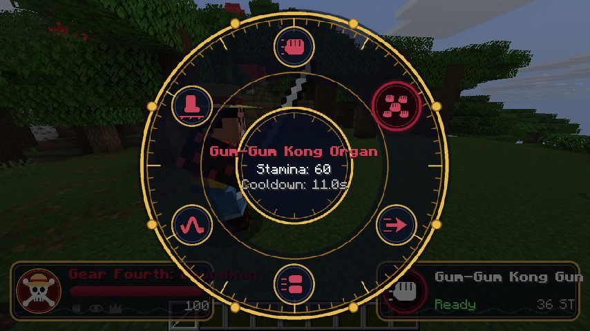
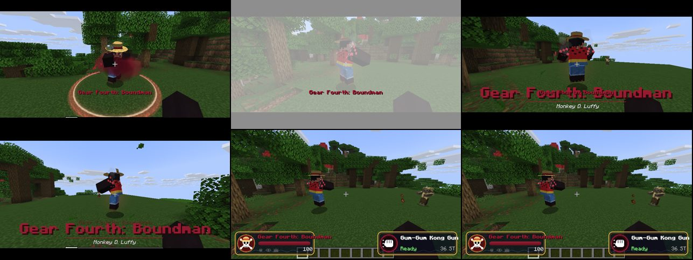
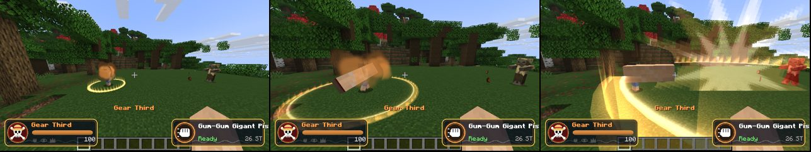
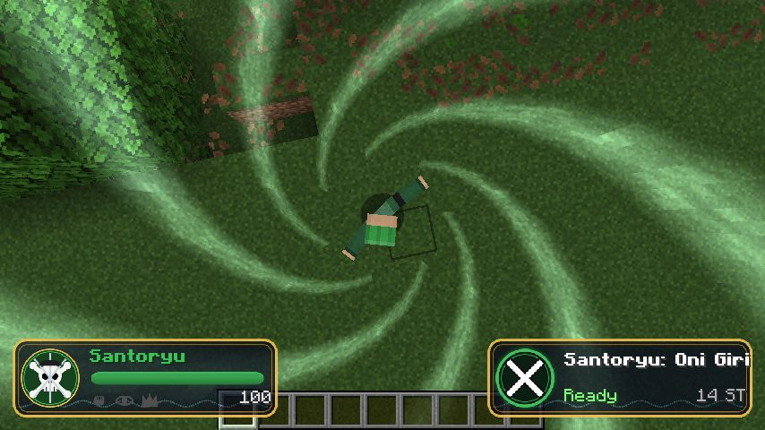
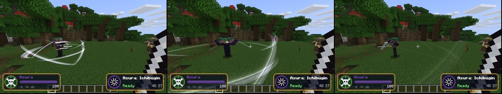
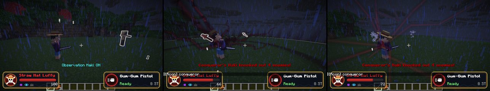
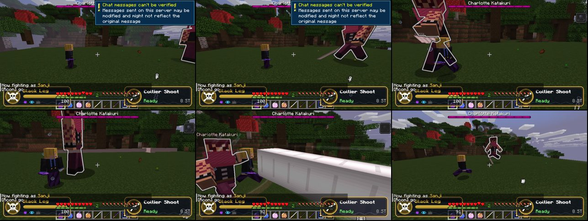
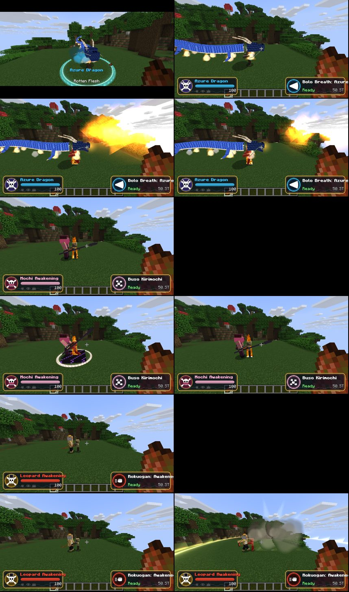

# One Piece: Straw Hat Powers

A Fabric mod for **Minecraft Java 26.2**. Fight as **Luffy, Zoro, Sanji, Kaido, Katakuri or Lucci**: 22 forms, 120 skills, all three kinds of Haki, transformation cutscenes, and boss fights against Kaido, Katakuri and Lucci, who transform mid-fight.

All effects, skins, models, icons and sounds were made for this mod. None are reused from vanilla.



## Install

1. Install **Fabric Loader 0.19.5** (or newer) for Minecraft 26.2 from https://fabricmc.net/use/.
2. Put **Fabric API 0.161.0+26.2** (or newer) in your `mods` folder.
3. Put `onepiece-1.0.0.jar` (from `dist/`, or from `build/libs/` after building) in your `mods` folder.
4. Minecraft 26.2 needs **Java 25**. The official launcher already uses it.

To build it yourself: `./gradlew build` with Java 25. The jar ends up in `build/libs/`.

## Getting powers

| Fighter | How to get it |
|---|---|
| Monkey D. Luffy | Eat the **Gum-Gum Fruit** |
| Roronoa Zoro | Right-click **Wado Ichimonji**, **Shusui** or **Enma**. Hold a sword to use his skills |
| Sanji | Read **Sanji's Cook Book** (right-click) |
| Kaido | Eat the **Fish-Fish Fruit, Model: Azure Dragon** |
| Charlotte Katakuri | Eat the **Mochi-Mochi Fruit** |
| Rob Lucci | Eat the **Cat-Cat Fruit, Model: Leopard** |

You can own every fighter at once and switch with **B**.

## Controls

All keys can be changed in Options > Controls > *One Piece Powers*.

| Key | What it does |
|---|---|
| **R** (tap) | Use the selected skill |
| **R** (hold) | Skill wheel: point at a skill and let go to pick it. Click to pick and use it right away |
| **V** (hold) | Form wheel: point at a form and let go to transform |
| **V** (tap) | Go back to your base form |
| **B** | Switch fighter |
| **H** | Armament Haki: black-coated limbs, +50% damage |
| **J** | Observation Haki: see every creature through walls, dodge 40% of hits |
| **K** | Conqueror's Haki: knocks out weak enemies around you, stuns the rest |
| **Space** in mid-air | Sky Walk (Sanji), Geppo (Lucci), bouncing (Gear 4 Boundman), cloud hops (Gear 5) |

Kaido's **Azure Dragon** form flies: double-tap Space, like creative flight.

## Fighters and forms

Each form has its own skin, body shape, aura, stats and skills. Big forms play a cutscene when you transform: the camera circles you, with cinema bars, speed lines, a flash and a title card. Finishing moves (like Bajrang Gun, Sanzen Sekai, Hell Memories, Thunder Storm, Hakai Mochi or Awakened Rokuogan) get a short cinematic too.

- **Luffy:** Base, Gear 2 (steam, speed), Gear 3 (giant limbs), Gear 4 Boundman / Snakeman / Tankman, Gear 5 (white, cloud scarf, cartoon powers, giant mode)
- **Zoro:** Santoryu (three swords, one in the mouth), Asura (three heads and nine swords), King of Hell (Enma's purple fire)
- **Sanji:** Black Leg, Diable Jambe (burning leg), Ifrit Jambe (blue fire), Raid Suit (invisible)
- **Kaido:** Human form with the Hassaikai club, Hybrid, Azure Dragon (flight, Bolo Breath, lightning storms)
- **Katakuri:** Mochi with Future Sight (built-in dodge), Mochi Awakening
- **Lucci:** Rokushiki (Shigan, Soru, Rankyaku, Tekkai, Rokuogan, Geppo), Leopard Hybrid, Leopard Awakening

The full list of skills with stamina costs and cooldowns is in [docs/SKILLS.md](docs/SKILLS.md).

Stamina (max 100) refills over time, faster in base form. Forms and Haki slowly drain it. If it runs out you drop back to base form and feel exhausted for a while, much longer after Gear 4 or Gear 5.

## Bosses

| Boss | Health | Phases | Drops |
|---|---|---|---|
| Kaido | 1024 | Human, then Hybrid at 70%, then Azure Dragon at 35% (flies) | Azure Dragon Fruit, Dragon Scale, Enma |
| Charlotte Katakuri | 1024 | Mochi, then Awakening at 50% (dodges hits with Future Sight) | Mochi Fruit, Mochi |
| Rob Lucci | 900 | Rokushiki, then Leopard Hybrid at 70%, then Awakening at 35% | Leopard Fruit, Leopard Fang, Cook Book |

Bosses use the same skills a player gets from their fruit. Summon them with spawn eggs or `/onepiece boss <name>`.

## Commands

You need operator permission (cheats on in single player).

| Command | What it does |
|---|---|
| `/onepiece fighter <luffy\|zoro\|sanji\|kaido\|katakuri\|lucci> [players]` | Give and switch to a fighter |
| `/onepiece unlockall [players]` | Unlock every fighter |
| `/onepiece form <form> [players]` | Transform right away, for example `gear_5`, `asura`, `kaido_dragon` |
| `/onepiece cast <skill> [players]` | Use any skill right away, for example `bajrang_gun` |
| `/onepiece infinite <true\|false> [players]` | No stamina costs or cooldowns |
| `/onepiece kit [players]` | Get every fruit, sword, book and piece of gear |
| `/onepiece boss <kaido\|katakuri\|lucci>` | Summon a boss in front of you |
| `/onepiece reset [players]` | Remove all powers |
| `/onepiece info [player]` | Show fighter, form and stamina |

## Recipes

| Item | Recipe |
|---|---|
| Gum-Gum Fruit | Golden Apple in the middle, Diamonds left and right, Cinnabar above and below, Slime Balls in the corners |
| Azure Dragon Fruit | Golden Apple, 2 Diamonds, Cinnabar, Blaze Rod, 4 Lapis Lazuli |
| Mochi Fruit | Golden Apple, 2 Diamonds, 2 Pink Dye, 4 Sugar |
| Leopard Fruit | Golden Apple, 2 Diamonds, Gold Ingot, Sulfur, 4 Leather |
| Wado Ichimonji | 2 Diamonds in a diagonal line, White Wool handle |
| Shusui | Netherite Scrap, Obsidian, Black Wool handle (diagonal) |
| Enma | Amethyst Shard, Netherite Ingot, Purple Wool handle (diagonal) |
| Sanji's Cook Book | Book, Blaze Powder, Bread, Cooked Beef (shapeless) |
| Straw Hat | 5 Wheat and 1 Red Dye in a hat shape |
| Zoro's Bandana | 5 Black Wool, helmet shape |
| Sanji's Suit | 7 Black Wool and 1 Blue Wool, chestplate shape |

All recipes show up in the recipe book. Crew gear gives a small bonus to its owner: the Straw Hat gives faster stamina regen, the bandana more sword damage, the suit more kick damage.

## Screenshots

| | |
|---|---|
|  |  |
|  |  |
|  |  |



## Settings

`config/onepiece-client.json` is created the first time you start the game:

```json
{
  "transformationCutscenes": true,
  "skillCutscenes": true,
  "cameraShake": true
}
```

Set any of them to `false` and restart the game to turn that effect off.

## Regenerating the art

All textures, skins and sounds come from the Python scripts in `tools/` (Pillow and NumPy, plus ffmpeg for sounds):

```
cd tools
python3 skins.py && python3 vfx_textures.py && python3 gui_textures.py && python3 items.py && python3 sounds.py && python3 lang.py
```

This is a fan-made mod and is not affiliated with One Piece, Eiichiro Oda, Shueisha, Toei Animation or Mojang. Please don't sell it.
